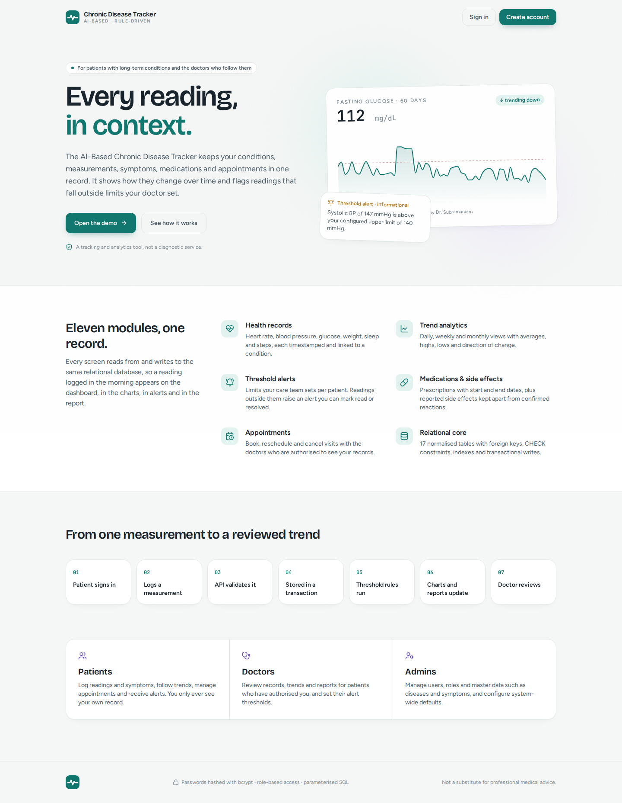
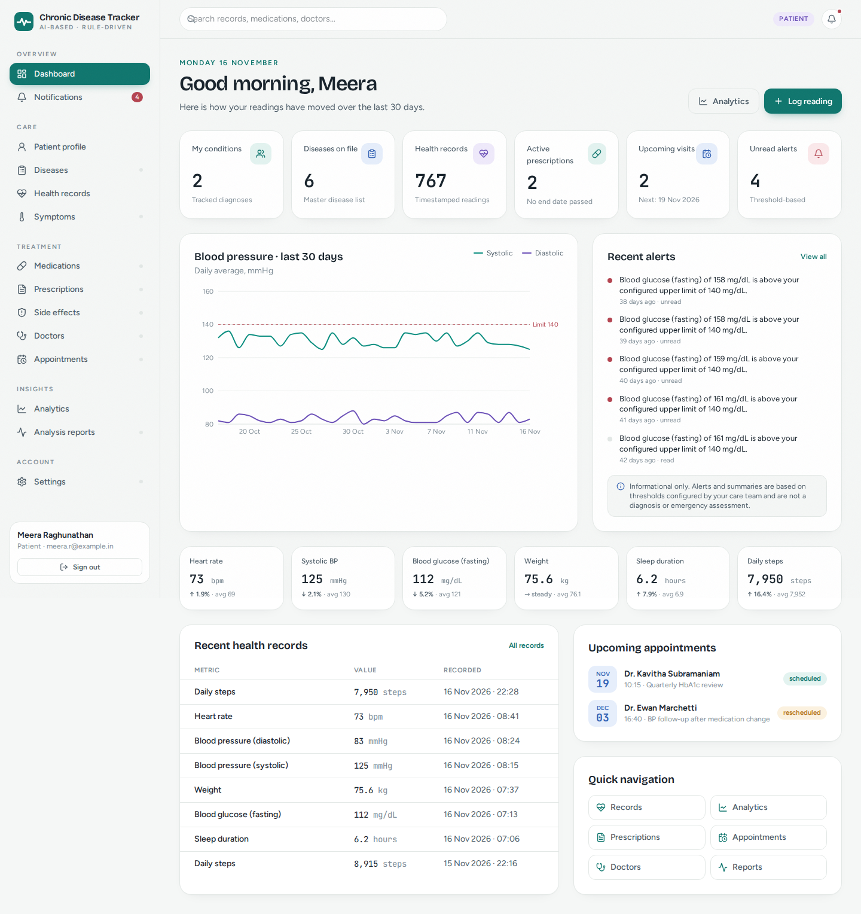

# AI-Based Chronic Disease Tracker

A web platform where patients with long-term conditions keep their diseases, timestamped health measurements, symptoms, medications, appointments and threshold-based alerts in one record, and where authorised doctors review the same trends. Analytics and alerts are rule-based and informational. The application does not diagnose.

Live Demo : https://chronicdisease-tracker.netlify.app/

## Screenshots

### Landing page



### Dashboard

Patient dashboard with demo data.



## What works today

The landing page, sign-in and registration, and an app shell with role-aware navigation (Patient, Doctor, Admin) are in place. Five screens are fully interactive:

- **Dashboard:** KPI tiles, blood-pressure trend, recent alerts, metric snapshot, recent records and upcoming appointments.
- **Health records:** filter, sort, paginate, add, edit and delete readings. Each reading can carry symptoms and notes and is validated before saving. Readings outside a configured threshold raise an alert.
- **Analytics:** Recharts trends for heart rate, blood pressure, glucose, sleep, steps and weight, with date ranges, daily/weekly/monthly grouping, average/min/max, trend direction, comparison with the previous period, and a table view.
- **Patient profile:** conditions, prescriptions, appointments and the health-history timeline.
- **Notifications:** read/unread/resolved alerts and the active threshold rules.

All screens currently read from one stub module, `src/data/fixtures.ts`, through `src/data/api.ts`. Each function there is named after the REST endpoint that replaces it. Changes made during a session (new records, resolved alerts) last until the page is reloaded.

## Tech stack

- React 19, TypeScript, Vite
- Tailwind CSS v4
- React Router 7
- Recharts
- lucide-react icons
- Planned: Express.js on Netlify Server, Netlify Database (managed Postgres) with Drizzle ORM and parameterised SQL, bcrypt and JWT. See [PLAN.md](./PLAN.md).

## Run locally

```bash
npm install
npm run dev            # Vite dev server
# or, with Netlify emulation (needed once the API exists):
netlify dev --port 8889
```

Sign in with any of the pre-filled demo roles on `/login`.

## Roadmap

Full details are in [PLAN.md](./PLAN.md).

1. Product surface (done)
2. Relational schema, constraints, indexes, seed data, Express server foundation
3. Authentication (bcrypt + JWT) and role-based access
4. Patient, disease, health record and symptom APIs and screens
5. Medications, prescriptions, side effects, doctors, appointments
6. SQL-driven analytics, saved analysis reports, alert-rule editor
7. Tests, DBMS concept documentation with `EXPLAIN`, API reference
